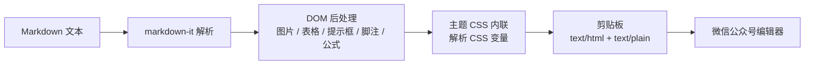

# 墨匣 Moxia

> 为微信公众号而生的 Markdown 排版工具。左侧书写，右侧即见成稿；一次复制，直接粘贴到公众号后台。


**Moxia** is a native macOS Markdown editor built for WeChat Official Accounts (微信公众号). Write on the left and see the publish-ready layout on the right. Copy once, paste into the WeChat editor, and your theme, code highlighting, math formulas and footnotes come along.

It is local-first: no account, no cloud, no telemetry. Rendering happens entirely on your Mac.

项目目前处于 0.1.0 早期阶段，主题格式与设置项仍可能调整。欢迎试用，也欢迎在 Issue 中反馈排版问题。

---

## 目录

- [为什么是墨匣](#为什么是墨匣)
- [功能](#功能)
- [快速开始](#快速开始)
- [使用指南](#使用指南)
- [主题与自定义](#主题与自定义)
- [工作原理](#工作原理)
- [项目结构](#项目结构)
- [开发](#开发)
- [已知限制](#已知限制)
- [常见问题](#常见问题)
- [参与贡献](#参与贡献)
- [许可证](#许可证)

## 为什么是墨匣

微信公众号编辑器不是浏览器：它不接受 `<style>` 和 class，会过滤外链，会折叠代码里的空白，也读不到你电脑上的图片。把一份排版精美的网页直接粘进去，往往会面目全非。

墨匣针对这些限制重新设计了渲染流程：

| 公众号的限制 | 墨匣的处理 |
| --- | --- |
| 丢弃 `<style>` 标签与 class | 把主题 CSS 逐条内联为元素上的 `style` |
| 正文只允许公众号文章链接 | 其他外链自动转成文末「参考链接」脚注 |
| 代码块中的空格与换行被折叠 | 空格转为 `&nbsp;`、换行转为 `<br>`，同时保留高亮结构 |
| 无法读取本机图片 | 复制时替换为「图片待上传 + 文件名」占位框，方便逐张补图 |
| 不支持 LaTeX | 公式在本地经 MathJax 渲染为自包含 SVG |

你只需要写 Markdown，剩下的交给墨匣。

## 功能

### 排版与预览

- **8 套原创文章主题**：从宋体朱砂的「墨韵」到品牌化的「慢富」，覆盖人文、技术、财经与生活等场景，详见[内置主题](#内置主题)
- **强调色**：内置 8 组精选色，也可用取色器自选；切换主题时自动回到该主题的默认色
- **7 种代码高亮配色**：GitHub、One Light、Xcode、GitHub Dark、One Dark、Nord、VS 2015
- **Mac 风格窗口**：代码块可选带红黄绿三个圆点的窗口装饰
- **GitHub 风格提示框**：`> [!TIP]`、`[!NOTE]`、`[!IMPORTANT]`、`[!WARNING]`、`[!CAUTION]`
- **数据卡片与柱状图**：用 `cards`、`chart` 代码块直接书写，无需图片或外部工具
- **数学公式**：行内 `$...$` 与块级 `$$...$$`，本地渲染为 SVG
- **图片排版**：独占一段的图片自动居中，`title` 或 `alt` 作为图注；表格过宽时可横向滚动
- **栏目框架**：front matter 中的 `label` 显示为文首栏目标签，`footer` 显示为文末署名

### 写作体验

- 原生 `NSTextView` 编辑器，带轻量 Markdown 语法高亮
- 编辑区与预览区左右分栏，滚动编辑区时预览同步滚动
- 实时字数统计（中文逐字、英文按词）与预计阅读时长（按 400 字/分钟）
- 自动保存草稿，下次启动自动恢复
- 首次启动载入一篇可编辑的示例文章，演示提示框、数据卡片、柱状图、公式与表格
- 打开、保存、另存为 `.md` 文件；在 Finder 中双击或用 `open` 命令也能打开
- 点击标题栏中的文档名即可原地重命名
- 粘贴截图或拖入图片文件，自动存入文档旁的 `assets/` 目录并以相对路径引用
- 窗口与预览背景跟随系统深浅色，文章本身保持主题配色；预览区带细窄的自绘滚动条

### 发布

- 标题栏「复制」或 `⇧⌘C`，同时写入富文本 HTML 与纯文本到剪贴板
- 粘贴后保留主题、字号、颜色、代码高亮、表格、卡片与公式
- 复制时自动补全 `<meta charset="utf-8">`，避免中文乱码
- 本地图片自动转为占位框，并提示需要补传的图片数量

### 隐私

- 渲染完全本地：Markdown、代码高亮与数学公式都在本机完成，不经过任何服务器
- 文章不上传，无账号体系，无统计埋点
- 除你在文章中主动引用的远程图片外，应用不发起网络请求
- 主题、草稿与设置都保存在本机

## 快速开始

### 环境要求

- macOS 14 Sonoma 或更高版本
- Xcode 15.3+（或 Swift 5.10+ 工具链）
- 无第三方 Swift 依赖；Markdown、高亮与公式库已随仓库提供

### 构建与运行

```bash
git clone https://github.com/chx9/moxia.git
cd moxia

./scripts/build-app.sh          # Release 构建，生成 build/Moxia.app
open build/Moxia.app
```

首次启动会载入 `Examples/welcome.md` 作为示例文章，直接删改即可开始写作。

调试构建：

```bash
./scripts/build-app.sh debug
```

开发时也可以直接运行：

```bash
swift run
```

或用 Xcode 打开 `Package.swift` 后运行 `Moxia` scheme。

### 安装到「应用程序」

```bash
cp -R build/Moxia.app /Applications/
```

应用使用 ad-hoc 签名，未做 Apple 公证。如果从网络下载后被 Gatekeeper 拦截，可右键点击应用选择「打开」，或执行：

```bash
xattr -dr com.apple.quarantine /Applications/Moxia.app
```

## 使用指南

### 基本流程

1. 新建或打开一篇 `.md` 文档。
2. 在左侧书写 Markdown，右侧实时预览最终效果。
3. 在标题栏切换文章主题，点击色点更换强调色；齿轮按钮打开常用设置。
4. 点击「复制」（`⇧⌘C`）。
5. 在公众号后台的正文编辑区直接粘贴（`⌘V`），检查图片与公式后发布。

标题栏右侧的「主题」菜单只负责文章主题；代码配色、正文排版、编辑器字体等更细的设置，在「设置 → 全部设置」（`⌘,`）中。

### 支持的 Markdown

墨匣使用 [markdown-it](https://github.com/markdown-it/markdown-it)，支持 CommonMark 与常用 GFM 语法：

| 语法 | 说明 |
| --- | --- |
| `# 标题` … `###### 标题` | 一至六级标题；预览中标题文字会包一层 `span.title`，便于主题加装饰 |
| `**加粗**` / `*斜体*` / `~~删除线~~` | 行内格式 |
| `- 项目` / `1. 项目` | 无序 / 有序列表；建议嵌套不超过两层 |
| `> 引用` | 引用块 |
| `---` | 分割线 |
| `\| 表格 \|` | GFM 表格，支持对齐语法 |
| 围栏代码块（如 `swift`） | 标注语言可获得高亮，未标注时自动识别 |
| `` `行内代码` `` | 行内代码 |
| `[文字](https://…)` | 链接；复制到公众号时按设置转为文末脚注 |
| `` | 图片；独占一段时居中，`title` 或 `alt` 作为图注 |
| `$E=mc^2$` / `$$…$$` | 行内 / 块级数学公式 |
| `<u>HTML</u>` | 原始 HTML 在预览中可用，但公众号可能过滤，建议优先使用 Markdown |

**不支持**：`[^1]` 脚注语法（外链会自动转为脚注）、`- [ ]` 任务列表、Emoji 短码（如 `:smile:`）。任务列表会被当作普通文本。

### 公众号增强组件

#### Front matter

文档开头可以用 `---` 包裹一段 front matter。只解析单行的「键: 值」，不支持嵌套 YAML。

```markdown
---
title: 文章标题
author: 作者
description: 一句话摘要
label: MONEY & LIFE · 理财小课堂
footer: 慢慢变富 · 每周六更新
---

正文从这里开始。
```

- `label` 会显示为文首的栏目标签（`eyebrow`）。
- `footer` 会显示为文末署名（`brand-footer`）。
- `title`、`author`、`description` 不会进入正文，但会保留在源文件中。

#### 提示框

```markdown
> [!TIP] 小标题（可省略）
> 提示框的正文，可以有多段。
```

支持五种类型，未写标题时使用默认标题：

| 写法 | 默认标题 | 用途 |
| --- | --- | --- |
| `[!NOTE]` | 说明 | 补充说明 |
| `[!TIP]` | 提示 | 技巧与建议 |
| `[!IMPORTANT]` | 重点 | 关键信息 |
| `[!WARNING]` | 注意 | 警告 |
| `[!CAUTION]` | 风险提示 | 高风险操作 |

`WARNING` 与 `CAUTION` 使用更醒目的暖色背景。

#### 数据卡片

用 `cards` 代码块，每行「标签 | 数值 | 说明」，一行建议 2–3 张：

````markdown
```cards
title: 本月数据
产品 A | 1,280 | 同比增长 32%
产品 B | 960 | 环比持平
note: 数据来源：内部统计
```
````

- `title:` 与 `note:` 行是可选的标题与注释，大小写不敏感，也支持中文冒号。
- 单元格支持行内 Markdown。
- 数值建议简短，过长会换行。

#### 柱状图

用 `chart` 代码块，每行「标签 | 数值」。柱高会按最大绝对值等比缩放，数值可以带单位：

````markdown
```chart
title: 各渠道收入
App | 12,000
小程序 | 8,600
线下 | 3,200
note: 单位：元
```
````

图表以纯 HTML/CSS 绘制，不依赖图片，因此在公众号中也能保持清晰。

### 图片

- **粘贴截图**：直接 `⌘V`，图片会保存到当前文档旁的 `assets/` 目录，并以相对路径引用。
- **拖入图片**：把图片文件拖进编辑器，效果与粘贴相同。
- **插入已有图片**：菜单「插入 → 图片…」（`⇧⌘I`），可多选。
- **手写图片**：路径含空格时用尖括号包裹，``。
- **未保存的文档**：粘贴图片会暂存到 `~/Library/Application Support/Moxia/Images/`，保存文档后建议重新插入以获得相对路径。

复制到公众号时，本地图片会变成「图片待上传 + 文件名」的占位框。粘贴后在公众号编辑器中选中占位框，插入对应图片即可。远程图片保留原 URL，粘贴后请确认是否正常显示。

### 快捷键

macOS 修饰键：`⌘` Command、`⌥` Option、`⇧` Shift。

| 文件与发布 | 快捷键 | 插入 | 快捷键 | 格式 | 快捷键 |
| --- | --- | --- | --- | --- | --- |
| 新建 | `⌘N` | 代码块 | `⌥⌘C` | 加粗 | `⌘B` |
| 打开… | `⌘O` | 表格 | `⌥⌘T` | 斜体 | `⌘I` |
| 保存 | `⌘S` | 公式 | `⌥⌘M` | 行内代码 | `⌥⌘E` |
| 另存为… | `⇧⌘S` | 图片链接 | `⌥⌘I` | 链接 | `⌘K` |
| 复制到公众号 | `⇧⌘C` | 图片… | `⇧⌘I` | 一 / 二 / 三级标题 | `⌘1` / `⌘2` / `⌘3` |
| 设置 | `⌘,` | 分割线 | `⌥⌘-` | 引用 | `⌥⌘Q` |
| | | | | 无序 / 有序列表 | `⌥⌘U` / `⌥⌘O` |

以上操作也可通过菜单栏「插入」「格式」，或编辑区右键菜单执行。有选中文字时，格式操作会包裹选区。

### 复制到公众号做了什么

1. 用 markdown-it 把 Markdown 解析为 HTML。
2. 后处理 DOM：提示框、图片与图注、表格包裹、外链脚注、代码空白保留、公式 SVG。
3. 读取基础样式、文章主题、代码主题与个人排版设置，逐条内联到元素上。
4. 解析 `var(--accent)` 等 CSS 变量，去掉 class、id 与 `data-*` 属性。
5. 把本地图片替换为占位框，生成最终 HTML。
6. 以 `text/html` 与 `text/plain` 两种格式写入剪贴板。

### 数据存放位置

| 内容 | 路径 |
| --- | --- |
| 自动保存的草稿 | `~/Library/Application Support/Moxia/Draft.md` |
| 自定义主题 | `~/Library/Application Support/Moxia/Themes/` |
| 未保存文档的粘贴图片 | `~/Library/Application Support/Moxia/Images/` |
| 偏好设置 | `~/Library/Preferences/app.moxia.Moxia.plist` |

## 主题与自定义

### 内置主题

| 主题 | 风格 | 适合 |
| --- | --- | --- |
| 墨韵 | 宋体衬线、朱砂点缀 | 人文随笔 |
| 素笺 | 克制、留白 | 大多数文章 |
| 晴空 | 明快的蓝 | 技术与产品 |
| 拾光 | 暖橙荧光笔 | 生活与读书笔记 |
| 格律 | 瑞士网格、黑白配红 | 设计与评论 |
| 焦糖 | 奶油白、深棕、焦糖 | 咖啡、美食与生活 |
| 时评 | 黑白报刊版式、中国红 | 财经、时评与政策解读 |
| 慢富 | 森林绿、奶油白、焦糖金 | 「慢慢变富」品牌文章 |

默认主题为「墨韵」。主题只决定排版与配色，不改变 Markdown 内容。

### 使用自定义主题

1. 打开「设置 → 全部设置 → 通用」。
2. 点击「打开」主题文件夹，放入一个 `.css` 文件。
3. 回到设置窗口点击「重新载入」，或切换到其他应用再切回来，新主题会出现在标题栏的主题菜单中，无需重启。

在外部编辑当前正在使用的主题 CSS 时，文件监听会自动触发预览刷新。

### 编写主题

公众号会丢弃 `<style>` 与 class，墨匣会把主题 CSS 逐条内联到元素上。因此主题需要遵循几条规则：

- **选择器以 `#moxia` 开头**，例如 `#moxia h2`、`#moxia h2 .title`（标题文字包在 `span.title` 中）。
- **规则按书写顺序覆盖，不计算选择器优先级**。后写的规则会覆盖前面的同名属性。
- **伪元素不会生效**（如 `::before`、`::after`）。
- **`@media`、`@font-face` 等 at-rule 不会生效**，内联阶段只处理普通样式规则。
- **不依赖伪类交互**：`#moxia a:hover` 之类的规则不会在静态文章里产生效果。
- 可用变量：`var(--accent)`、`var(--accent-soft)`、`var(--accent-light)`。在 `#moxia { --accent: #xxxxxx; }` 中声明默认值；未声明时，浅色版本会由强调色与白色混合自动生成。
- 建议只使用公众号编辑器能够保留的属性：字体、字号、颜色、背景、边框、圆角、内外边距、行高、字间距、文本对齐等。

一个最小示例：

```css
/* 我的主题：青瓷 */
#moxia {
  --accent: #2f6f5e;
  font-family: "Songti SC", "Noto Serif SC", serif;
  font-size: 16px;
  line-height: 1.9;
  letter-spacing: 0.4px;
  padding: 24px 20px;
  background: #fbfaf6;
}

#moxia h2 .title {
  padding-left: 10px;
  border-left: 3px solid var(--accent);
}

#moxia strong {
  color: var(--accent);
}

#moxia blockquote {
  border-left: 3px solid var(--accent-light);
  background: var(--accent-soft);
}
```

内置主题位于 `Sources/Moxia/Resources/Renderer/themes/`，可以作为更完整的参考。

### 添加到内置主题列表

如果要让主题成为所有用户都能看到的默认主题：

1. 把 `your-theme.css` 放进 `Sources/Moxia/Resources/Renderer/themes/`。
2. 在 `Sources/Moxia/ThemeLibrary.swift` 的 `builtInThemes` 中加入 `("your-theme", "主题名")`。
3. 重新构建。

代码高亮主题同理：CSS 放进 `Sources/Moxia/Resources/Renderer/code/`，再在 `ThemeLibrary.codeThemes` 中登记。

## 工作原理

墨匣由两层组成：Swift 负责原生窗口、编辑器和文件管理，JavaScript 负责 Markdown 渲染与样式内联。



- **AppState**：单一数据源，持有文档、设置与渲染状态；输入后 120ms 防抖重绘，草稿 1 秒防抖保存。
- **MarkdownEditor**：`NSTextView` 包装，负责语法高亮、撤销、图片粘贴与拖入。
- **PreviewController**：持有 `WKWebView`，通过 `callAsyncJavaScript` 调用渲染核心；渲染请求会合并，只保留最新一次，避免高频输入时堆积。
- **moxia.js**：真正的渲染管线，包含 front matter、Markdown 解析、组件、公式、CSS 内联与复制输出。
- **ThemeLibrary**：加载内置主题与用户主题；开发时优先读取源码目录，修改 CSS 无需重新编译。

为什么用 WebView 而不是原生富文本？Markdown 解析、代码高亮和数学公式都有成熟可靠的 JavaScript 实现，而公众号最终需要的也是 HTML，直接在 WebView 中生成并内联样式最直接。Swift 只负责把它嵌进一个轻量、快速的原生外壳里。

## 项目结构

```text
Moxia/
├── Package.swift                 SwiftPM 清单
├── Examples/welcome.md           首次启动的示例文章（可直接编辑）
├── Sources/Moxia/
│   ├── MoxiaApp.swift            应用入口、菜单命令、文件打开
│   ├── AppState.swift            文档、设置、渲染调度、剪贴板
│   ├── ContentView.swift         主界面（编辑 | 预览）
│   ├── HeaderBar.swift           自绘标题栏
│   ├── AccentPicker.swift        强调色选择
│   ├── MarkdownEditor.swift      NSTextView 编辑器与语法高亮
│   ├── EditorActions.swift       插入 / 格式操作与右键菜单
│   ├── PreviewController.swift   WKWebView 预览与 Swift ↔ JS 桥
│   ├── ThemeLibrary.swift        主题加载与自定义主题目录
│   ├── SettingsModel.swift       字体与数值选项
│   ├── SettingsView.swift        快速设置与完整设置窗口
│   ├── Welcome.swift             示例文章加载
│   └── Resources/Renderer/
│       ├── index.html            预览页面
│       ├── moxia.js              渲染核心：Markdown → 内联样式 HTML
│       ├── themes/*.css          8 套文章主题
│       ├── code/*.css            7 套代码高亮主题
│       └── vendor/               markdown-it、highlight.js、MathJax
├── Support/Info.plist            应用元数据与文档类型
├── scripts/
│   ├── build-app.sh              构建 .app
│   └── make-icon.swift           生成应用图标
├── ThirdPartyLicenses/           第三方许可证
├── .claude/skills/moxia-article/ 可选的 Claude Code 文章整理技能
├── CONTRIBUTING.md
└── LICENSE
```

`moxia.js` 同时暴露 `window.moxia.render`、`scrollTo` 与 `getOutput` 三个接口，供 Swift 调用；`index.html` 负责预览容器、滚动条与少量键盘交互。

## 开发

### 常用命令

```bash
swift build                     # Debug 构建
swift build -c release          # Release 构建
swift run                       # 直接运行
./scripts/build-app.sh          # 打包 build/Moxia.app（Release）
./scripts/build-app.sh debug    # 打包 Debug 版本
```

`build-app.sh` 会依次执行：`swift build`、复制可执行文件与 `Info.plist`、复制 `Renderer` 资源、按需生成图标、ad-hoc 签名。

### 开发时的资源热更新

开发模式下，`ThemeLibrary.rendererURL` 会优先指向源码中的 `Resources/Renderer`，而不是构建产物。因此：

- 修改主题 CSS 后无需重新编译；
- 当前主题文件被外部修改时，`DispatchSource` 文件监听会自动触发重绘；
- 应用重新激活时会重新载入主题列表。

修改 Swift 代码仍需重新构建。

### 示例文章

首次启动的示例文章位于 `Examples/welcome.md`。应用优先读取源码目录中的这份文件；打包时 `build-app.sh` 会把它复制到应用的 `Contents/Resources/Examples/`。修改后重启应用即可看到效果。文件缺失时会退回一段简短的欢迎语。

### 版本号

版本写在 `Support/Info.plist` 的 `CFBundleShortVersionString`。发布前请同步更新 `CFBundleVersion`。

### 测试

项目目前没有自动化测试目标。欢迎为以下部分补充测试：

- `moxia.js` 的 front matter、组件与 CSS 内联逻辑（可借助 jsdom 等 DOM 环境在 Node 中运行）；
- `AppState` 的字数统计、文件读写与设置持久化；
- `EditorActions` 的插入、包裹与行前缀切换。

## 已知限制

- **本地图片无法直接进入公众号**：复制时替换为占位框，需要在公众号编辑器中逐张补图。
- **公众号的过滤规则会变化**：墨匣的预览是近似结果，发布前请在公众号后台实际确认排版、公式与卡片。
- **自定义主题只支持可内联的普通样式规则**：伪元素、`@media`、`@font-face` 等不会生效。
- **外链会变成脚注**：公众号正文只允许公众号文章链接；其他链接会被移除，因此墨匣把它们收进文末「参考链接」。可在「设置 → 通用」中关闭该行为，但链接仍可能被公众号过滤。
- **不推荐原始 HTML**：预览支持，但公众号通常会过滤标签与样式。
- **不支持任务列表与 `[^1]` 脚注语法**。
- **仅支持 macOS 14+**：没有 Windows、Linux 或 iOS 版本。
- **构建架构跟随构建机**：在 Apple Silicon 上构建的是 arm64 版本，在 Intel 上构建的是 x86_64 版本，仓库不提供预构建的通用二进制。
- **未公证、无自动更新**：应用为 ad-hoc 签名，首次打开可能需要绕过 Gatekeeper。

## 常见问题

**粘贴到公众号后样式丢失了？**

请在公众号后台的图文正文编辑区直接粘贴富文本，不要粘贴到纯文本编辑器或 Markdown 源码模式。若仍然丢失，请确认复制时没有把内容先转成纯文本，并附上示例 Markdown 与 macOS 版本提交 Issue。

**为什么链接变成了 `[1]`？**

公众号正文不允许普通外链。墨匣默认把外链收进文末脚注；如需保留链接文字，可在「设置 → 通用」关闭「外链转为文末脚注」，但公众号仍可能移除链接。

**图片为什么变成了占位框？**

本地图片的路径只在你的电脑上有效，公众号服务器读不到。请在公众号编辑器中选中占位框，插入对应图片。远程图片请确认公众号是否允许外链。

**公式、卡片或表格在公众号里显示不对？**

预览与公众号编辑器使用不同的渲染环境。请先把示例 Markdown 与截图发到 Issue，方便定位是内联样式还是公众号过滤规则的问题。

**支持 Windows 或网页版吗？**

目前只支持 macOS 14+。核心渲染逻辑在 `moxia.js` 中，理论上可以复用到其他外壳，但尚未实现。

**可以导出 HTML 或 PDF 吗？**

目前没有导出功能，只提供「复制到公众号」的富文本剪贴板输出。

## 参与贡献

欢迎提交 Issue 与 Pull Request。无论是报告问题、改进主题、补充文档还是添加测试，都有帮助。

- 提交前请先阅读 [CONTRIBUTING.md](CONTRIBUTING.md)。
- 报告排版问题时，请附上最小可复现的 Markdown、macOS 版本与相关截图。
- 新增内置主题时，请同时提供主题截图或效果说明。

## 许可证

本项目以 [MIT License](LICENSE) 发布，Copyright © 2026 Moxia Contributors。

第三方组件及其许可证见 [ThirdPartyLicenses/](ThirdPartyLicenses/)：

- [markdown-it](https://github.com/markdown-it/markdown-it)（MIT）
- [highlight.js](https://github.com/highlightjs/highlight.js)（BSD 3-Clause）
- [MathJax](https://www.mathjax.org/)（Apache-2.0）

## 致谢

感谢上述开源项目的作者与维护者。墨匣的文章主题、应用图标与界面均在本项目中原创实现；文章字体使用系统字体，不随应用分发字体文件。
