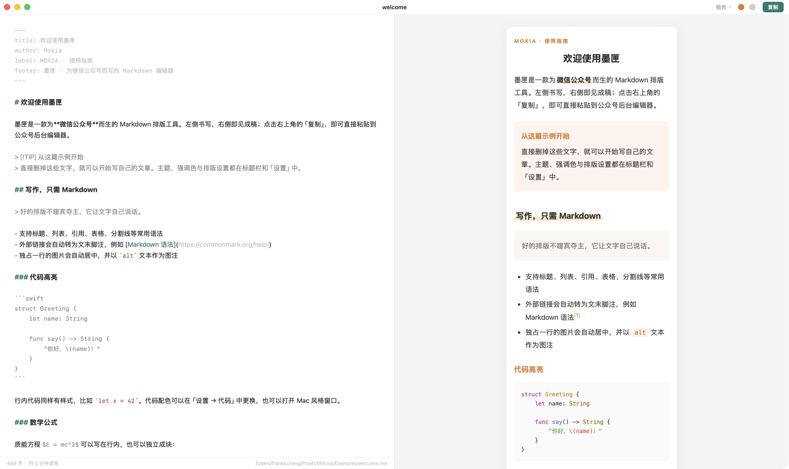

# 墨匣 Moxia

> 为微信公众号而生的 Markdown 排版工具。左侧书写，右侧即见成稿；一次复制，直接粘贴到公众号后台。


**Moxia** is a native macOS Markdown editor for WeChat Official Accounts. Write on the left, preview the publish-ready layout on the right, then copy once and paste into the WeChat editor. Themes, code highlighting, math and footnotes are preserved.

It is local-first: no account, no cloud, no telemetry. Rendering happens entirely on your Mac.



> 当前为 0.1.0 早期版本，主题格式与设置项可能调整。

## 为什么是墨匣

公众号编辑器不是浏览器：它会丢弃 `<style>` 与 class、过滤外链、折叠代码空白，也读不到本机图片。墨匣在复制前把主题样式逐条内联、把外链收进文末脚注、保留代码空白，并把公式渲染为 SVG，因此粘进去的排版更接近预览。

## 功能

- **8 套文章主题**、8 组强调色、7 套代码高亮配色，代码块可选 Mac 窗口装饰
- **公众号适配**：CSS 内联、外链转脚注、代码空白保留、本地图片占位、公式转 SVG
- **增强组件**：GitHub 风格提示框、数据卡片、柱状图
- **写作体验**：分栏实时预览、滚动同步、字数统计、自动保存草稿、粘贴或拖入图片、标题栏重命名
- **本地优先**：渲染与数据都在本机，无账号、无云端、无统计

## 快速开始

需要 macOS 14+、Xcode 15.3+（Swift 5.10+）。没有第三方 Swift 依赖。

```bash
git clone https://github.com/chx9/moxia.git
cd moxia
./scripts/build-app.sh
open build/Moxia.app
```

首次启动会载入 `Examples/welcome.md`，直接删改即可开始写作。调试构建用 `./scripts/build-app.sh debug`，开发时也可以 `swift run`。

安装到「应用程序」：

```bash
cp -R build/Moxia.app /Applications/
```

应用使用 ad-hoc 签名，未做 Apple 公证。如果被 Gatekeeper 拦截，右键选择「打开」，或执行：

```bash
xattr -dr com.apple.quarantine /Applications/Moxia.app
```

## 使用

1. 新建或打开一篇 `.md` 文档。
2. 在左侧书写 Markdown，右侧实时预览。
3. 在标题栏切换文章主题与强调色；`⌘,` 打开更多排版设置。
4. 点击「复制」（`⇧⌘C`），在公众号后台的正文编辑区粘贴。

标题栏的主题菜单只负责文章主题；代码配色、正文排版与编辑器字体在「设置 → 全部设置」中。

### Markdown

墨匣使用 [markdown-it](https://github.com/markdown-it/markdown-it)，支持 CommonMark 与常用 GFM 语法：

| 语法 | 说明 |
| --- | --- |
| `# 标题` … `###### 标题` | 一至六级标题 |
| `**加粗**` / `*斜体*` / `~~删除线~~` | 行内格式 |
| `- 项目` / `1. 项目` / `> 引用` / `---` | 列表、引用、分割线 |
| 表格 | GFM 表格，支持对齐 |
| 围栏代码块 | 标注语言可获得高亮 |
| `` `行内代码` `` | 行内代码 |
| `[文字](https://…)` | 外链；复制到公众号时转为文末脚注 |
| `` | 独占一段时居中，`title` 或 `alt` 作为图注 |
| `$E=mc^2$` / `$$…$$` | 行内 / 块级数学公式 |
| `<u>HTML</u>` | 预览可用，公众号可能过滤，建议优先使用 Markdown |

不支持 `[^1]` 脚注语法、`- [ ]` 任务列表与 Emoji 短码（如 `:smile:`）。

### Front matter

文档开头可用 `---` 包裹一段 front matter。只解析单行的「键: 值」，不支持嵌套 YAML。

```markdown
---
title: 文章标题
author: 作者
description: 一句话摘要
label: MONEY & LIFE · 理财小课堂
footer: 林间札记 · 每周六更新
---

正文从这里开始。
```

`label` 显示为文首栏目标签，`footer` 显示为文末署名；`title`、`author`、`description` 不进入正文，但会保留在源文件中。

### 提示框

```markdown
> [!TIP] 小标题（可省略）
> 提示框正文，可以有多段。
```

| 写法 | 默认标题 | 用途 |
| --- | --- | --- |
| `[!NOTE]` | 说明 | 补充说明 |
| `[!TIP]` | 提示 | 技巧与建议 |
| `[!IMPORTANT]` | 重点 | 关键信息 |
| `[!WARNING]` | 注意 | 警告 |
| `[!CAUTION]` | 风险提示 | 高风险操作 |

### 数据卡片与柱状图

用 `cards` 代码块写数据卡片，每行「标签 | 数值 | 说明」：

````markdown
```cards
title: 本月数据
产品 A | 1,280 | 同比增长 32%
产品 B | 960 | 环比持平
note: 数据来源：内部统计
```
````

用 `chart` 代码块写柱状图，每行「标签 | 数值」，柱高按最大值等比缩放：

````markdown
```chart
title: 各渠道收入
App | 12,000
小程序 | 8,600
线下 | 3,200
note: 单位：元
```
````

`title:` 与 `note:` 可选，大小写不敏感，也支持中文冒号；单元格支持行内 Markdown。

### 图片

- **粘贴截图**：`⌘V`，图片保存到文档旁的 `assets/` 目录，并以相对路径引用。
- **拖入图片**：效果与粘贴相同。
- **插入已有图片**：菜单「插入 → 图片…」（`⇧⌘I`），可多选。
- **未保存的文档**：图片暂存到 `~/Library/Application Support/Moxia/Images/`，保存后建议重新插入。

复制到公众号时，本地图片会变成「图片待上传 + 文件名」的占位框，粘贴后在公众号中逐张补图即可。远程图片保留原 URL。

### 快捷键

| 操作 | 快捷键 |
| --- | --- |
| 新建 / 打开 / 保存 | `⌘N` / `⌘O` / `⌘S` |
| 另存为 | `⇧⌘S` |
| 复制到公众号 | `⇧⌘C` |
| 设置 | `⌘,` |
| 加粗 / 斜体 / 行内代码 / 链接 | `⌘B` / `⌘I` / `⌥⌘E` / `⌘K` |
| 代码块 / 表格 / 公式 / 图片 | `⌥⌘C` / `⌥⌘T` / `⌥⌘M` / `⇧⌘I` |
| 一 / 二 / 三级标题 | `⌘1` / `⌘2` / `⌘3` |
| 引用 / 无序列表 / 有序列表 | `⌥⌘Q` / `⌥⌘U` / `⌥⌘O` |
| 分割线 | `⌥⌘-` |

以上操作也可通过菜单栏「插入」「格式」或编辑区右键菜单执行；有选中文字时，格式操作会包裹选区。

### 复制到公众号

1. 用 markdown-it 把 Markdown 解析为 HTML。
2. 后处理提示框、图片与图注、表格、外链脚注、代码空白与公式 SVG。
3. 读取主题、代码配色与排版设置，逐条内联为元素上的 `style`。
4. 本地图片替换为占位框，并以 `text/html` 与 `text/plain` 写入剪贴板。

### 数据位置

| 内容 | 路径 |
| --- | --- |
| 自动保存的草稿 | `~/Library/Application Support/Moxia/Draft.md` |
| 自定义主题 | `~/Library/Application Support/Moxia/Themes/` |
| 未保存文档的粘贴图片 | `~/Library/Application Support/Moxia/Images/` |
| 偏好设置 | `~/Library/Preferences/app.moxia.Moxia.plist` |

## 主题与自定义

### 内置主题

| 主题 | 风格 | 适合 |
| --- | --- | --- |
| 墨韵 | 宋体衬线、朱砂点缀 | 人文随笔 |
| 素笺 | 克制、留白 | 大多数文章 |
| 晴空 | 明快的蓝 | 技术与产品 |
| 拾光 | 暖橙荧光笔 | 生活与读书笔记 |
| 格律 | 瑞士网格、黑白配红 | 设计与评论 |
| 焦糖 | 奶油白、深棕、焦糖 | 咖啡、美食与生活 |
| 时评 | 黑白报刊版式、中国红 | 财经、时评与政策解读 |
| 森屿 | 森林绿、奶油白、焦糖金 | 品牌与生活方式文章 |

默认主题为「墨韵」。主题只决定排版与配色，不改变 Markdown 内容。

### 自定义主题

打开「设置 → 全部设置 → 通用」，点击「打开」主题文件夹，放入 `.css` 文件，再点「重新载入」即可。外部修改当前主题时，预览会自动刷新。

公众号会丢弃 `<style>` 与 class，因此主题 CSS 会被逐条内联，编写时注意：

- 选择器以 `#moxia` 开头，例如 `#moxia h2`、`#moxia h2 .title`。
- 规则按书写顺序覆盖，不计算选择器优先级。
- 伪元素、`@media`、`@font-face` 等不会生效。
- 可用变量：`var(--accent)`、`var(--accent-soft)`、`var(--accent-light)`。
- 建议只使用字体、字号、颜色、背景、边框、圆角、间距、行高、对齐等可内联属性。

更完整的写法可以参考 `Sources/Moxia/Resources/Renderer/themes/` 中的内置主题。要让主题成为所有用户可见的内置主题，把 CSS 放进该目录，并在 `ThemeLibrary.swift` 的 `builtInThemes` 中登记；代码高亮主题同理，放进 `code/` 后登记到 `codeThemes`。

## 工作原理

Swift 负责窗口、编辑器、文件与剪贴板；JavaScript 负责 Markdown 解析、组件、公式与样式内联。`AppState` 是单一数据源，输入后 120 ms 防抖重绘、草稿 1 秒防抖保存；`PreviewController` 通过 `WKWebView` 调用 `moxia.js`。

```text
Moxia/
├── Package.swift
├── Examples/welcome.md           首次启动的示例文章
├── docs/screenshot.png           README 界面截图
├── Sources/Moxia/
│   ├── MoxiaApp.swift            应用入口与菜单
│   ├── AppState.swift            文档、设置、渲染调度、剪贴板
│   ├── ContentView.swift         主界面（编辑 | 预览）
│   ├── HeaderBar.swift           自绘标题栏
│   ├── AccentPicker.swift        强调色选择
│   ├── MarkdownEditor.swift      NSTextView 编辑器
│   ├── EditorActions.swift       插入与格式操作
│   ├── PreviewController.swift   WKWebView 与 Swift ↔ JS 桥
│   ├── ThemeLibrary.swift        主题加载
│   ├── SettingsModel.swift       字体与数值选项
│   ├── SettingsView.swift        设置窗口
│   ├── Welcome.swift             示例文章加载
│   └── Resources/Renderer/
│       ├── index.html            预览页面
│       ├── moxia.js              渲染核心
│       ├── themes/*.css          文章主题
│       ├── code/*.css            代码高亮主题
│       └── vendor/               markdown-it、highlight.js、MathJax
├── Support/Info.plist
├── scripts/
│   ├── build-app.sh              构建 .app
│   └── make-icon.swift           生成应用图标
├── ThirdPartyLicenses/
├── CONTRIBUTING.md
└── LICENSE
```

## 开发

```bash
swift build                     # Debug 构建
swift build -c release          # Release 构建
swift run                       # 直接运行
./scripts/build-app.sh          # 打包 build/Moxia.app
./scripts/build-app.sh debug    # 打包 Debug 版本
```

开发模式下，`ThemeLibrary` 会优先读取源码中的 `Resources/Renderer`，修改主题 CSS 无需重新编译；修改 Swift 代码仍需重新构建。示例文章位于 `Examples/welcome.md`，打包时会复制到应用的 `Contents/Resources/Examples/`。

版本号写在 `Support/Info.plist` 的 `CFBundleShortVersionString`，发布前请同步更新 `CFBundleVersion`。项目目前没有自动化测试目标，欢迎为 `moxia.js` 的渲染与 CSS 内联、`AppState` 的文件读写、`EditorActions` 的编辑操作补充测试。

## 已知限制

- **本地图片无法直接进入公众号**：复制时替换为占位框，需要逐张补图。
- **预览是近似结果**：公众号的过滤规则会变化，发布前请在后台实际确认。
- **自定义主题只支持可内联的普通样式规则**：伪元素、`@media`、`@font-face` 不生效。
- **外链会变成脚注**：可在「设置 → 通用」关闭，但公众号仍可能过滤链接。
- **不推荐原始 HTML**：预览支持，公众号通常会过滤标签与样式。
- **不支持任务列表与 `[^1]` 脚注语法**。
- **仅支持 macOS 14+**：构建架构跟随构建机，不提供通用二进制。
- **未公证、无自动更新**：首次打开可能需要绕过 Gatekeeper。

## 常见问题

**粘贴到公众号后样式丢失？**

请在公众号后台的图文正文编辑区直接粘贴富文本，不要粘贴到纯文本编辑器或 Markdown 源码模式。

**为什么链接变成了 `[1]`？**

公众号正文不允许普通外链。墨匣默认把外链收进文末脚注；可在「设置 → 通用」关闭该行为，但链接仍可能被公众号移除。

**图片为什么变成了占位框？**

本地图片路径只在你的电脑上有效，公众号服务器读不到。请在公众号编辑器中选中占位框，插入对应图片。

**支持 Windows、导出 HTML 或 PDF 吗？**

目前只支持 macOS 14+，也没有导出功能，只提供「复制到公众号」的富文本输出。

## 参与贡献

欢迎提交 Issue 与 Pull Request。报告排版问题时，请附上最小可复现的 Markdown、macOS 版本与截图；新增主题时请附预览图与适用场景。提交前请阅读 [CONTRIBUTING.md](CONTRIBUTING.md)。

## 许可证

本项目以 [MIT License](LICENSE) 发布，Copyright © 2026 Moxia Contributors。

第三方组件及其许可证见 [ThirdPartyLicenses/](ThirdPartyLicenses/)：[markdown-it](https://github.com/markdown-it/markdown-it)（MIT）、[highlight.js](https://github.com/highlightjs/highlight.js)（BSD 3-Clause）、[MathJax](https://www.mathjax.org/)（Apache-2.0）。

## 致谢

感谢上述开源项目的作者与维护者。文章主题、应用图标与界面均在本项目中原创实现。
