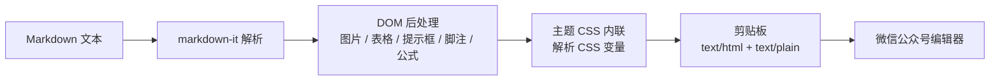

# 工作原理与开发

[← 返回 README](../README.md)

## 工作原理

墨匣由两层组成：Swift 负责原生窗口、编辑器和文件管理，JavaScript 负责 Markdown 渲染与样式内联。



- **AppState**：单一数据源，持有文档、设置与渲染状态；输入后 120ms 防抖重绘，草稿 1 秒防抖保存。
- **MarkdownEditor**：`NSTextView` 包装，负责语法高亮、撤销、图片粘贴与拖入。
- **PreviewController**：持有 `WKWebView`，通过 `callAsyncJavaScript` 调用渲染核心；渲染请求会合并，只保留最新一次，避免高频输入时堆积。
- **moxia.js**：真正的渲染管线，包含 front matter、Markdown 解析、组件、公式、CSS 内联与复制输出。
- **ThemeLibrary**：加载内置主题与用户主题；开发时优先读取源码目录，修改 CSS 无需重新编译。

为什么用 WebView 而不是原生富文本？Markdown 解析、代码高亮和数学公式都有成熟可靠的 JavaScript 实现，而公众号最终需要的也是 HTML，直接在 WebView 中生成并内联样式最直接。Swift 只负责把它嵌进一个轻量、快速的原生外壳里。

## 项目结构

```text
Moxia/
├── Package.swift                 SwiftPM 清单
├── Examples/welcome.md           首次启动的示例文章（可直接编辑）
├── docs/
│   ├── screenshot.png            README 界面截图
│   ├── guide.md                  使用指南
│   ├── themes.md                 主题与自定义
│   ├── development.md            工作原理与开发
│   └── faq.md                    常见问题与限制
├── Sources/Moxia/
│   ├── MoxiaApp.swift            应用入口、菜单命令、文件打开
│   ├── AppState.swift            文档、设置、渲染调度、剪贴板
│   ├── ContentView.swift         主界面（编辑 | 预览）
│   ├── HeaderBar.swift           自绘标题栏
│   ├── AccentPicker.swift        强调色选择
│   ├── MarkdownEditor.swift      NSTextView 编辑器与语法高亮
│   ├── EditorActions.swift       插入 / 格式操作与右键菜单
│   ├── PreviewController.swift   WKWebView 预览与 Swift ↔ JS 桥
│   ├── ThemeLibrary.swift        主题加载与自定义主题目录
│   ├── SettingsModel.swift       字体与数值选项
│   ├── SettingsView.swift        快速设置与完整设置窗口
│   ├── Welcome.swift             示例文章加载
│   └── Resources/Renderer/
│       ├── index.html            预览页面
│       ├── moxia.js              渲染核心：Markdown → 内联样式 HTML
│       ├── themes/*.css          8 套文章主题
│       ├── code/*.css            7 套代码高亮主题
│       └── vendor/               markdown-it、highlight.js、MathJax
├── Support/Info.plist            应用元数据与文档类型
├── scripts/
│   ├── build-app.sh              构建 .app
│   └── make-icon.swift           生成应用图标
├── ThirdPartyLicenses/           第三方许可证
├── .claude/skills/moxia-article/ 可选的 Claude Code 文章整理技能
├── CONTRIBUTING.md
└── LICENSE
```

`moxia.js` 同时暴露 `window.moxia.render`、`scrollTo` 与 `getOutput` 三个接口，供 Swift 调用；`index.html` 负责预览容器、滚动条与少量键盘交互。

## 常用命令

```bash
swift build                     # Debug 构建
swift build -c release          # Release 构建
swift run                       # 直接运行
./scripts/build-app.sh          # 打包 build/Moxia.app（Release）
./scripts/build-app.sh debug    # 打包 Debug 版本
```

`build-app.sh` 会依次执行：`swift build`、复制可执行文件与 `Info.plist`、复制 `Renderer` 资源、按需生成图标、ad-hoc 签名。

## 开发时的资源热更新

开发模式下，`ThemeLibrary.rendererURL` 会优先指向源码中的 `Resources/Renderer`，而不是构建产物。因此：

- 修改主题 CSS 后无需重新编译；
- 当前主题文件被外部修改时，`DispatchSource` 文件监听会自动触发重绘；
- 应用重新激活时会重新载入主题列表。

修改 Swift 代码仍需重新构建。

## 示例文章

首次启动的示例文章位于 `Examples/welcome.md`。应用优先读取源码目录中的这份文件；打包时 `build-app.sh` 会把它复制到应用的 `Contents/Resources/Examples/`。修改后重启应用即可看到效果。文件缺失时会退回一段简短的欢迎语。

## 版本号

版本写在 `Support/Info.plist` 的 `CFBundleShortVersionString`。发布前请同步更新 `CFBundleVersion`。

## 测试

项目目前没有自动化测试目标。欢迎为以下部分补充测试：

- `moxia.js` 的 front matter、组件与 CSS 内联逻辑（可借助 jsdom 等 DOM 环境在 Node 中运行）；
- `AppState` 的字数统计、文件读写与设置持久化；
- `EditorActions` 的插入、包裹与行前缀切换。

提交前至少执行一次 `./scripts/build-app.sh`，确保打包流程可完成。

---

[← 返回 README](../README.md) · [使用指南](guide.md) · [主题与自定义](themes.md) · [常见问题与限制](faq.md)
